# 정처기학습 플랫폼

> 흩어진 정보처리기사 실기 자료를 모아 **개념 학습 → 문제 풀이 → 오답 복습 → 개인 요약**으로 이어지게 만든 웹 서비스입니다.

| 항목 | 내용 |
| --- | --- |
| 프로젝트 형태 | 개인 프로젝트 · 기획 및 운영, AI 코딩 도구를 활용한 개발 |
| 개발 기록 | 2026.09.22 첫 커밋 이후 지속 개선 중 |
| 문서 기준일 | 2026.10.31 |
| 주요 사용자 | 정보처리기사 실기를 준비하며 개념 정리와 반복 풀이가 필요한 수험생 |
| 서비스 | [정처기학습 플랫폼 바로가기](https://information-processing-study.vercel.app/) |
| 저장소 | [GitHub 소스 코드](https://github.com/gyeonggumun/information-processing-study) |
| 주요 기술 | React 19 · JavaScript · Vite 8 · React Router 7 · Supabase · PostgreSQL · Vercel · pdf-lib |

**화면 안내:** 아래 이미지는 실제 프로젝트의 React 컴포넌트를 로컬 데모 환경에서 실행해 촬영했습니다. 닉네임·이메일·문의·풀이 기록·회원 수는 예시 데이터이며 실제 이용 현황이 아닙니다. 긴 페이지는 하단까지 전체 캡처했고, 학습 모달은 내용을 빠짐없이 담기 위해 캡처 환경에서 내부 스크롤을 펼쳤습니다. 운영 화면에서는 모달 내부를 스크롤합니다. 이미지를 클릭하면 원본 크기로 볼 수 있습니다.

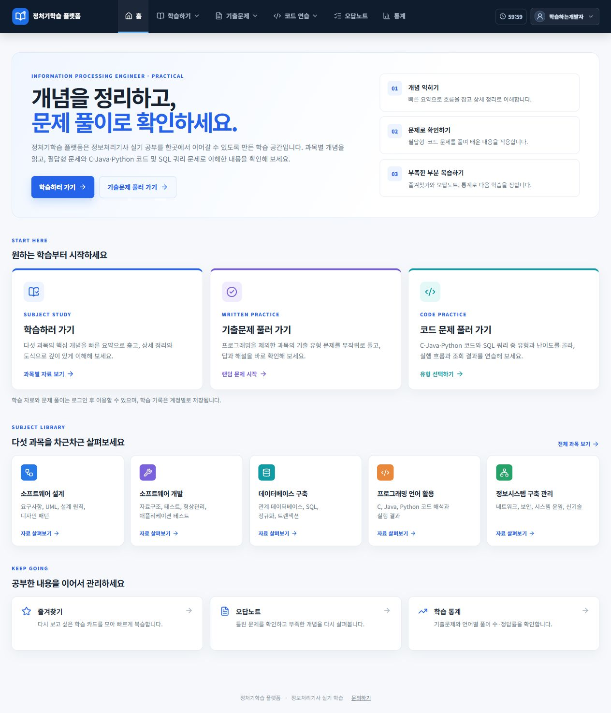

*홈에서는 학습 순서와 서비스의 목적을 설명하고, 자료 학습·필답형 문제·코드 연습으로 이동할 수 있습니다.*

## 1. 문제 정의 — 무엇이 불편했는가?

정보처리기사 실기는 개념을 외우는 것뿐 아니라 C·Java·Python의 실행 흐름, SQL 결과, 네트워크와 운영체제 계산까지 함께 준비해야 합니다. 자료를 읽는 곳과 문제를 푸는 곳이 나뉘어 있으면 틀린 문제를 다시 찾거나, 시험 직전에 필요한 개념만 모으는 과정이 번거로워집니다.

이 프로젝트에서는 학습 과정의 다음 불편을 해결하고자 했습니다.

| 문제 | 서비스에 반영한 방향 |
| --- | --- |
| 긴 요약 자료에서 필요한 개념을 찾기 어렵다. | 다섯 과목을 주제별 카드로 나누고 빠른 요약과 상세 정리를 제공한다. |
| 비슷한 용어의 정의를 읽어도 차이를 구별하기 어렵다. | 정의에 예시·구별 기준·비교 표를 함께 배치한다. |
| 코드 문제의 정답만 보면 어디서 잘못 생각했는지 알기 어렵다. | 원문 코드, 실행 순서별 주석, 단계별 풀이와 SQL 결과 표를 제공한다. |
| 이미 푼 문제가 반복되고 틀린 문제는 다시 찾기 어렵다. | 새 문제 출제에서는 기록된 문제를 제외하고, 풀이 기록과 오답노트를 분리한다. |
| 시험 전 복습 자료를 매번 따로 만들어야 한다. | 즐겨찾기와 개인 실기 요약을 제공하고, 남긴 카드만 PDF로 내보낸다. |
| 문제 제목이 풀이 방법이나 정답을 미리 알려준다. | 코드 제목을 언어 중심으로 통일하고 오답노트에는 출처·과목 중심 제목을 사용한다. |

목표는 기능을 각각 만드는 데 그치지 않고, **배운 내용을 문제로 확인하고 부족한 부분을 다시 학습할 수 있는 흐름**을 만드는 것이었습니다.

## 2. 나의 역할 — 어디까지 담당했는가?

개인 프로젝트로 서비스의 목적, 기능 우선순위, 학습 방식과 운영 정책을 정했습니다. 실제 사용 화면을 확인하면서 카드의 분량, 설명의 깊이, 문제 제목, 모바일 이동 방식 등을 반복적으로 조정했습니다.

| 영역 | 담당한 범위 |
| --- | --- |
| 기획·요구사항 | 학습·문제 풀이·복습의 흐름 정의, 기능별 요구사항과 권한 정책 수립 |
| UI·UX 방향 | 과목 카드, 요약·상세 모달, 난이도 선택, 사용자 메뉴와 관리자 화면 구성 |
| 학습 콘텐츠 | 기출 유형을 바탕으로 주제 선정, 비교 설명·계산 예제·문제 해설의 보강 방향 결정 |
| 기능 구현·연결 | React 화면, 계정별 기록, 즐겨찾기·개인 요약, PDF 내보내기, 문의·관리 기능 구성 |
| 품질 관리 | 오타·표·답안·해설 점검, 제목 힌트 제거, 모바일 잘림과 뒤로가기 문제 개선 |
| 배포·운영 | GitHub 변경 이력 관리, Vercel 배포 연결, 로그인·권한·세션 정책 구성 |

**개발 방식:** 코드 작성·수정, 검증 스크립트와 문서 작업에는 Codex 등 AI 개발 도구를 활용했습니다. 기능 요구사항을 구체화하고 결과 화면을 검토하며 개선 방향을 결정하는 방식으로 진행했습니다. 전체 코드를 도구 도움 없이 직접 작성했다는 의미의 프로젝트는 아닙니다.

## 3. 접근과 의사결정 — 어떻게 해결했는가?

### 3-1. 읽기와 복습에 맞춰 학습 자료의 깊이를 나누기

처음부터 긴 문서를 한 화면에 보여주기보다 과목 → 주제 카드 → 요약 또는 상세 정리 순서로 접근하도록 구성했습니다. 한 카드를 지나치게 잘게 나누면 맥락을 잃고, 너무 많이 합치면 읽기 어려워지므로 **하나의 주제로 함께 설명할 수 있는 내용**을 카드 단위로 묶었습니다.

빠른 요약은 핵심 정의와 구별점을 중심으로, 상세 정리는 예시와 비교 표를 포함하도록 구성했습니다. 전체 개요 카드는 넓은 흐름을 파악하는 용도로, 세부 학습 카드는 특정 주제를 복습하는 용도로 사용합니다.

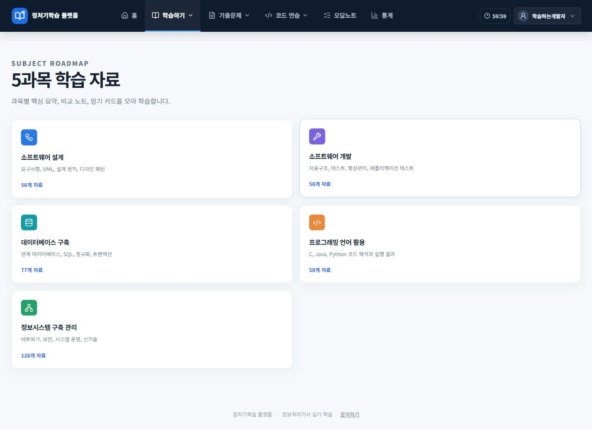

*소프트웨어 설계·소프트웨어 개발·데이터베이스 구축·프로그래밍 언어 활용·정보시스템 구축 관리의 다섯 과목으로 진입합니다.*

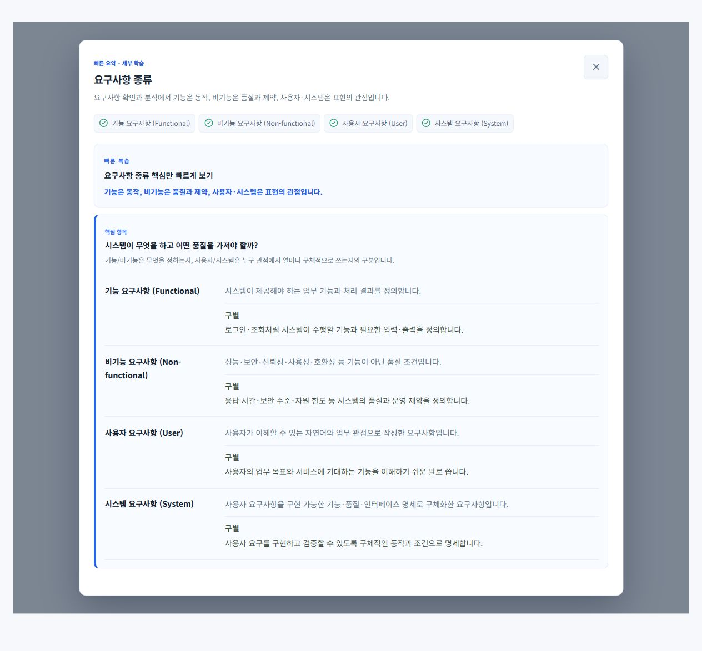

*빠른 요약에서는 기능·비기능 요구사항과 사용자·시스템 요구사항이 서로 다른 분류 기준임을 함께 설명합니다.*

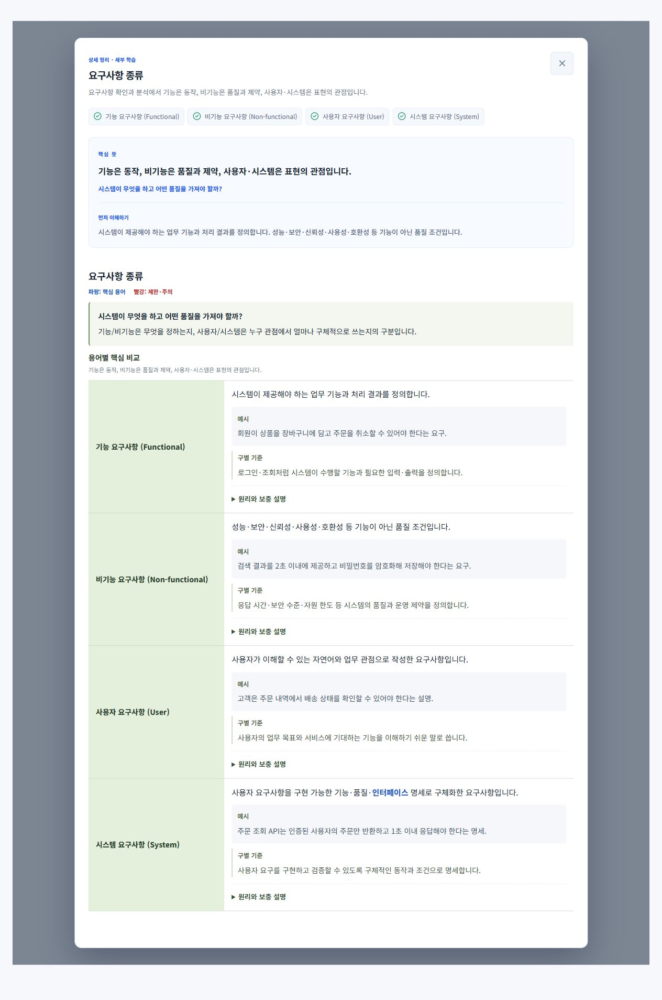

*상세 정리는 같은 주제를 예시·구별 기준·비교 표까지 확장합니다. 이 이미지는 모달 내부 전체 내용을 펼쳐 촬영한 화면입니다.*

**선택 이유:** 요약과 상세를 서로 다른 자료로 관리하면 설명이 어긋날 수 있습니다. 같은 학습 자료를 읽는 깊이에 따라 보여주고, 즐겨찾기와 실기 요약에서도 같은 학습 모달을 재사용하도록 구성했습니다.

### 3-2. 언어와 난이도를 선택한 뒤 문제에 집중하기

코드 연습은 C·Java·Python·SQL로 나누고 각 유형에서 하·중·상 난이도를 선택하도록 구성했습니다. 난이도를 선택하면 같은 페이지 안에 무작위 문제가 표시되며, 풀이 기록이 있는 문제는 새 출제 대상에서 제외됩니다.

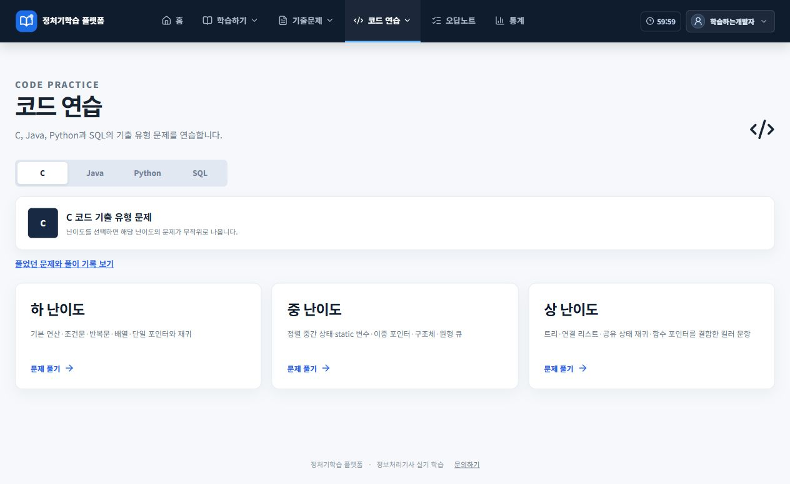

*언어 선택과 난이도 선택을 먼저 제공해 학습자가 연습 범위를 정할 수 있도록 했습니다.*

문제 제목에 알고리즘이나 핵심 문법이 드러나면 학습자가 코드를 읽기 전에 답을 추측할 수 있습니다. 이를 줄이기 위해 코드 제목을 `C 코드 문제`, `Java 코드 문제`, `Python 코드 문제`, `SQL 쿼리 문제`로 통일했습니다. 같은 언어 메뉴를 다시 선택하면 난이도 선택부터 시작하도록 화면 상태도 초기화합니다.

**구현 범위:** 사용자가 임의의 소스 코드를 서버에서 실행하는 온라인 IDE가 아니라, 제시된 코드의 실행 결과나 SQL 답안을 작성하는 실기형 연습입니다.

### 3-3. 정답뿐 아니라 실행 과정을 설명하기

코드 해설은 정답 문자열만 제시하지 않고, 원문 코드와 주석을 단 코드, 순서대로 정리한 풀이를 함께 보여줍니다. 변수의 값이 언제 바뀌는지, 어떤 저장 공간을 가리키는지, 출력문에서 무엇이 찍히는지 구분해 설명합니다.

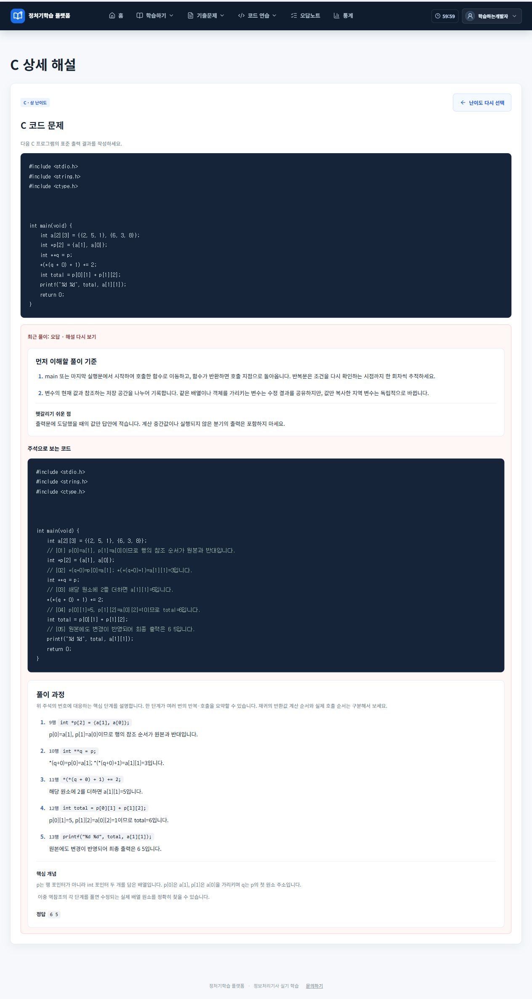

*배열과 포인터가 연결되는 예제입니다. 문제 코드, 주석으로 보는 코드, 실행 과정과 정답을 한 흐름으로 제공합니다.*

SQL은 원본 표를 보고 JOIN·GROUP BY·HAVING 등을 머릿속으로만 계산하기 어렵다는 점에 주목했습니다. 해설에서 중간 처리 결과와 완성 표를 보여주어 어떤 행이 결합되고 어떤 그룹이 남는지 확인할 수 있도록 했습니다.

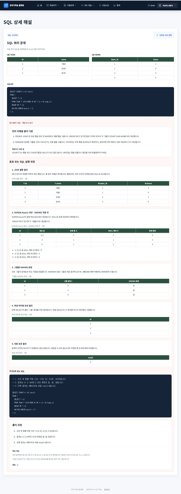

*두 표를 JOIN하고 그룹 조건을 적용하는 예제입니다. 해설의 표와 SQL 주석을 함께 보며 결과를 추적할 수 있습니다.*

**선택 이유:** 실행 과정을 추적할 수 있어야 숫자나 변수명이 바뀐 문제에도 적용할 수 있습니다. 코드의 계산 결과와 해설이 서로 맞는지는 별도의 실행·표 검증 스크립트로 점검하는 구조를 사용했습니다.

### 3-4. 필답형 연습과 복원·유사 문제의 목적을 구분하기

일반 기출 유형 연습은 프로그래밍을 제외한 네 과목에서 무작위로 출제하고 답을 직접 입력하도록 구성했습니다. 제목이나 분류에 정답을 암시하는 정보가 과도하게 노출되지 않도록 간결하게 표시합니다.

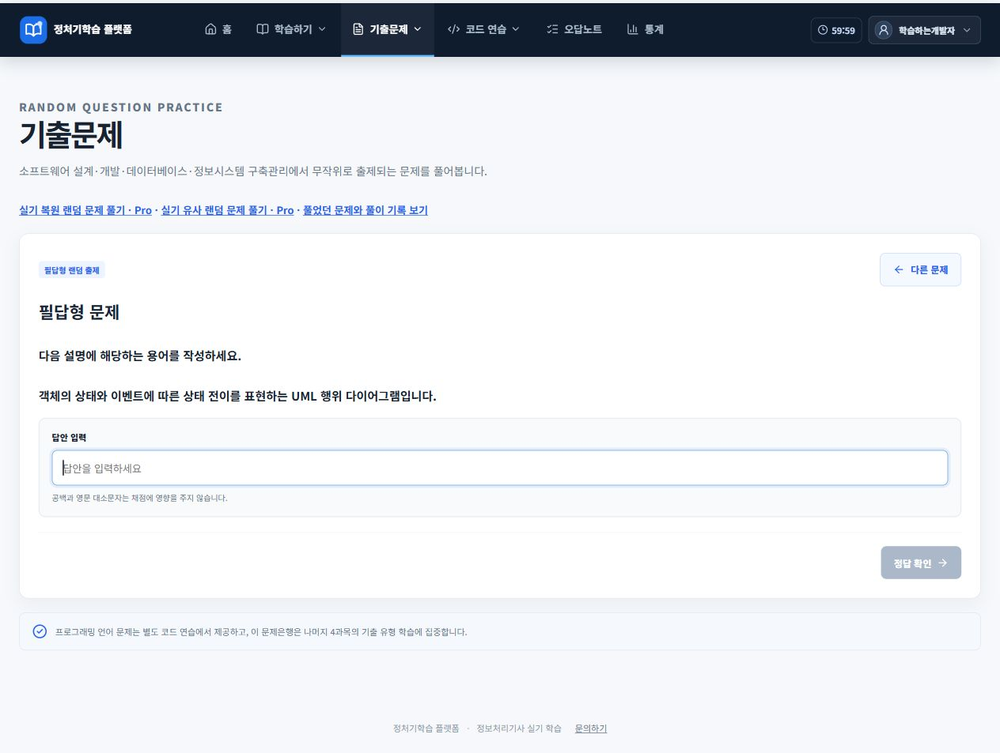

*객관식 선택 대신 용어를 직접 작성합니다. 일반 연습은 등록된 답안과 허용 표현을 바탕으로 채점합니다.*

복원 문제와 변형 문제는 목적을 나누어 별도 페이지로 제공합니다. 복원 문제는 회차별 출처가 있는 자료를 학습용으로 재구성한 문제이고, 유사 문제는 그 유형을 참고해 조건·코드·데이터 등을 바꾼 창작·변형 문제입니다.

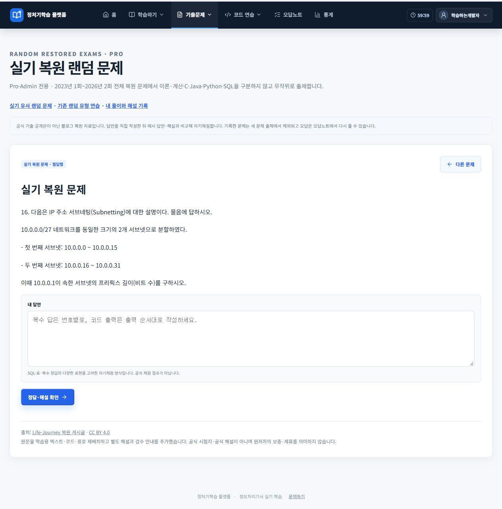

*현재 복원 페이지는 2023년 1회부터 2026년 2회까지의 자료를 포함합니다. 출처와 이용 조건, 공식 시험지·공식 해설이 아니라는 안내를 표시합니다.*

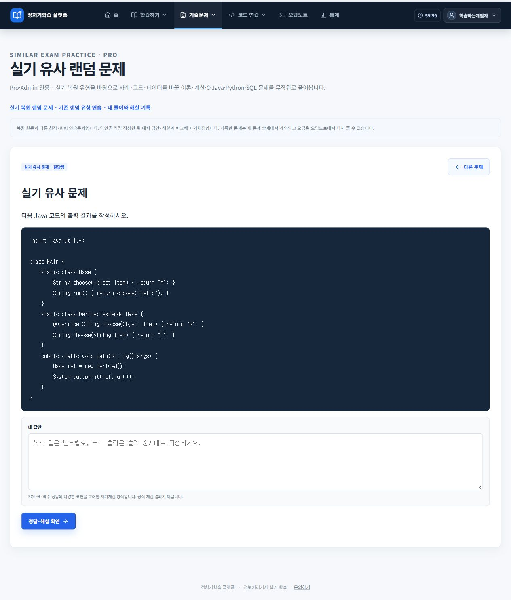

*복원 유형을 다른 조건에서 연습하는 화면입니다. 원문 복원 문제와 창작·변형 문제를 구분해 안내합니다.*

**채점 방식의 선택:** 복원·유사 문제는 복수 정답, SQL 표현, 표 답안 등의 차이를 고려해 예시 답안과 해설을 확인한 뒤 자기채점합니다. 이를 일반 자동 채점이나 공식 시험 채점과 동일한 것으로 표현하지 않습니다. 두 페이지는 Pro 이상이 이용할 수 있습니다.

### 3-5. 새 문제, 오답, 풀이 기록의 역할을 나누기

한 번 푼 문제를 새 문제 목록에서 계속 보여주면 학습 범위가 넓어지지 않습니다. 반대로 완전히 숨기면 나중에 해설을 다시 읽을 수 없습니다. 이를 해결하기 위해 새 출제 대상과 복습 경로를 분리했습니다.

| 화면 | 역할 |
| --- | --- |
| 랜덤 문제 | 기록이 없는 문제를 우선 학습하는 경로 |
| 오답노트 | 마지막 풀이가 오답인 문제를 다시 푸는 경로 |
| 풀이 기록 | 정답·오답과 관계없이 풀었던 문제와 해설을 다시 보는 경로 |
| 통계 | 풀이 기록을 유형별로 집계해 현재 학습 상태를 보는 경로 |

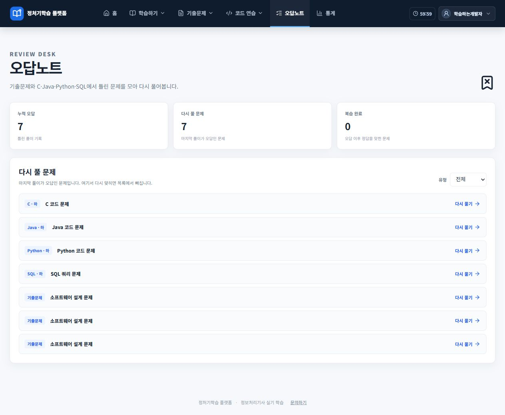

*다시 풀어 맞힌 문제는 재풀이 목록에서 빠집니다. 목록에서는 상세한 문제명을 숨기고 과목·출처 또는 언어 중심으로 표시합니다.*

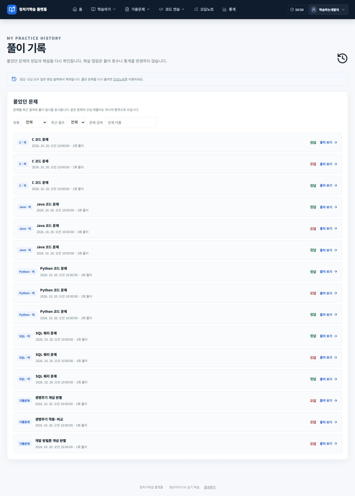

*이전에 푼 문제는 별도 기록에서 검색·필터링하고 해설을 다시 확인할 수 있습니다.*

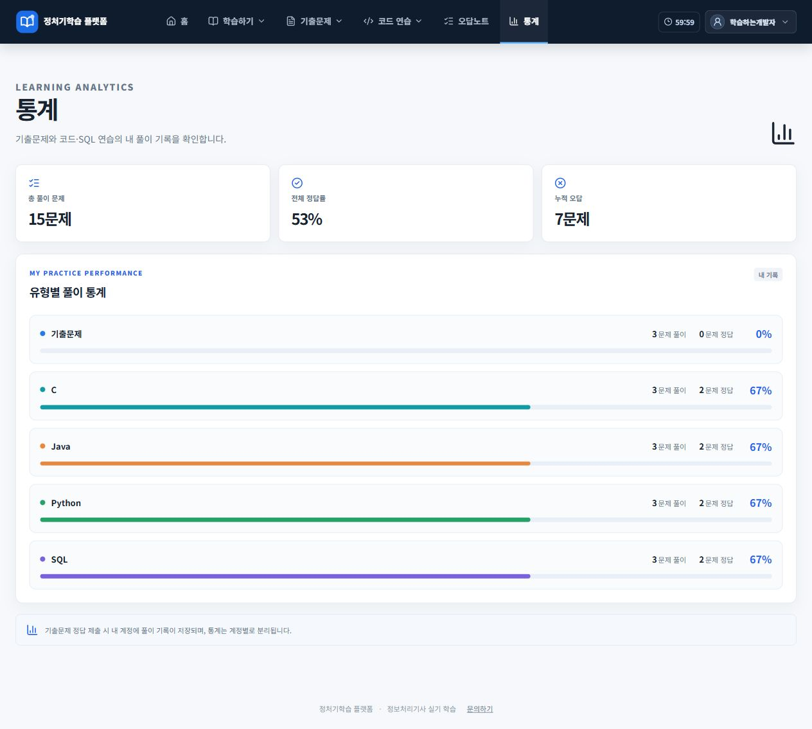

*기출문제·C·Java·Python·SQL별 풀이 수, 정답 수와 정답률을 표시합니다. 화면의 15문제·53%는 데모 기록의 집계이며 서비스 성과 수치가 아닙니다.*

**데이터 설계:** 문제 ID와 풀이 기록을 연결해 문제 본문을 수정하더라도 기존 기록을 유지하는 방향을 사용했습니다. 통계의 풀이 수는 제출한 풀이 기록 기준으로, 재풀이를 포함하므로 서로 다른 문제의 개수와는 구분됩니다.

### 3-6. 개인 복습 자료를 만들고 PDF로 이어가기

즐겨찾기는 자주 보는 학습 카드를 모으는 기능입니다. 카드 순서를 드래그로 조정할 수 있고, 목록 안에서 빠른 요약과 상세 정리를 모두 열 수 있습니다.

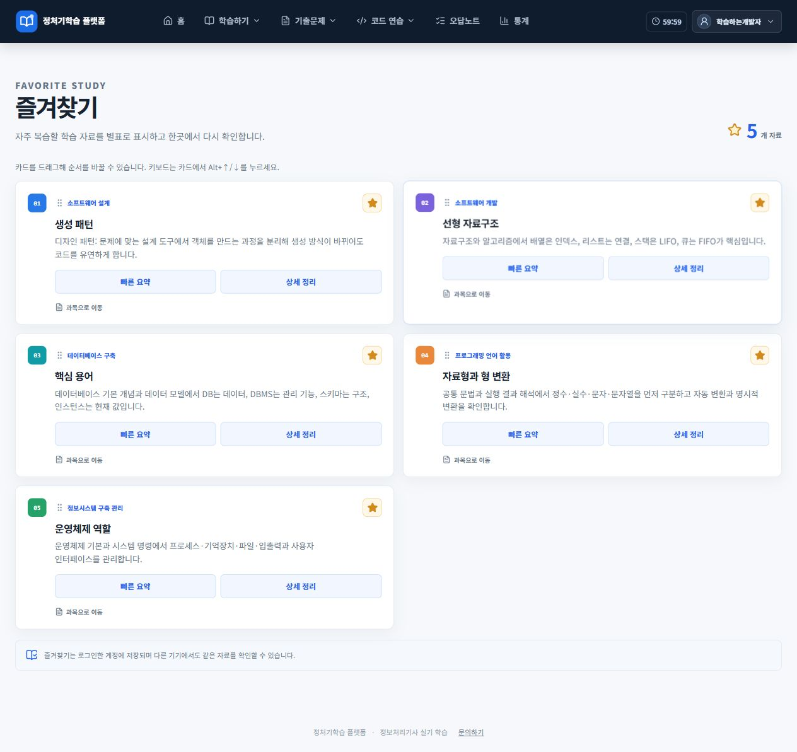

실기 요약은 Pro 이상 사용자가 개인 복습 자료를 구성하는 공간입니다. 공통 기본 목록에서 시작하되 학습 페이지에서 카드를 추가하고, 삭제·복원·순서 변경을 개인 계정에 저장합니다. 다른 사용자의 목록은 바뀌지 않습니다.

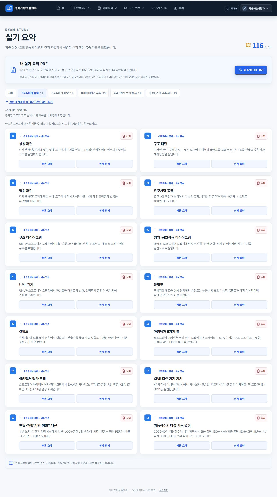

*소프트웨어 설계 과목을 선택한 화면입니다. PDF는 화면의 과목 필터와 관계없이 다운로드 시점에 내 전체 목록에 남아 있는 카드를 기준으로 생성됩니다.*

**PDF 생성의 선택:** 공통 PDF 파일을 그대로 내려주는 대신, 미리 조판한 카드 자료에서 사용자가 남긴 부분을 골라 브라우저에서 새 PDF로 구성합니다. 과목별로 모으되 과목 안의 개인 순서는 유지하고, 관련 카드가 남아 있을 때만 계산 예제를 포함합니다. 이 기능에는 `pdf-lib`를 사용했습니다.

이를 통해 웹에서 정리한 목록과 내려받은 자료가 일치하도록 했습니다. 계정 전환이나 페이지 이동으로 작업이 취소되면 이전 계정의 PDF를 뒤늦게 내려받지 않도록 처리했습니다.

### 3-7. 로그인·개인 기록·권한을 함께 설계하기

홈에서는 서비스 소개를 볼 수 있고, 학습과 문제 풀이를 시작할 때 로그인을 요구합니다. Google 로그인 후 처음 사용하는 닉네임을 설정하며, 로그인 완료 후에는 메인 페이지에서 시작합니다.

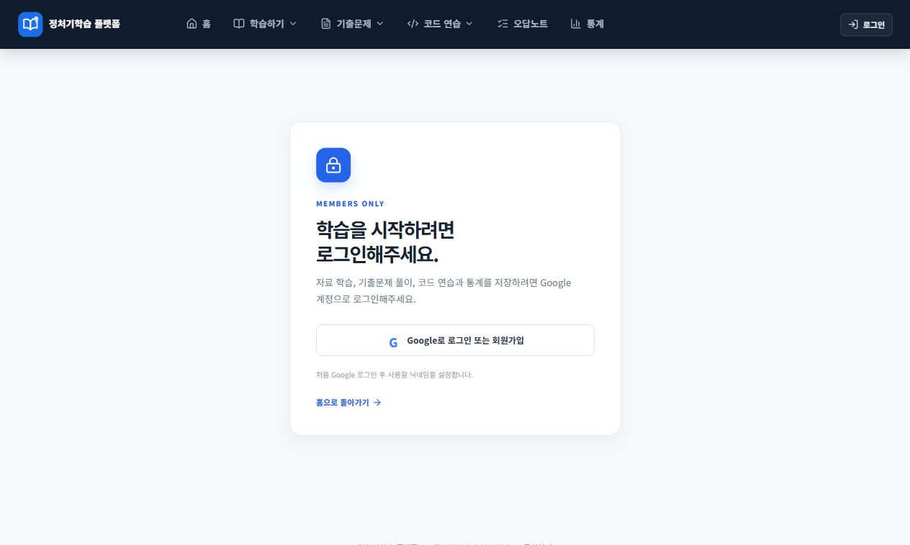

| 권한 | 이용 범위 |
| --- | --- |
| User | 일반 학습·기출 유형 연습·코드 연습·오답노트·통계·즐겨찾기·문의 |
| Pro | User 기능 + 실기 요약·개인 PDF·실기 복원·유사 문제 |
| Admin | Pro 기능 + 사용자 계정 관리·문의 관리 |

메뉴를 숨기는 처리와 별도로, 개인 데이터에는 소유권을 확인하는 RLS 정책을 사용하고 관리자 작업에는 서버 권한 검사를 적용했습니다. 계정별 최신 로그인 세션을 확인하고, 일반 사용자와 Pro 사용자는 1시간 동안 활동이 없으면 로그아웃하도록 구성했습니다. 남은 시간은 사용자 메뉴 옆에서 확인할 수 있으며 관리자는 비활동 시간 제한에서 제외됩니다.

**설계 범위:** Pro는 접근 등급이며 결제·구독 기능을 뜻하지 않습니다. 학습 콘텐츠 일부는 정적 웹·PDF 자산으로 배포되므로, 페이지 권한 제어를 콘텐츠 파일 자체의 완전한 비공개 보관과 동일하게 보지 않습니다.

### 3-8. 운영 중 생기는 문의와 계정 관리까지 연결하기

학습자가 오류나 자료 관련 질문을 남길 수 있도록 문의 페이지를 구성했습니다. 사용자는 본인 문의와 답변을 확인하고, 관리자는 전체 문의를 확인해 처리 상태와 답변을 관리합니다.

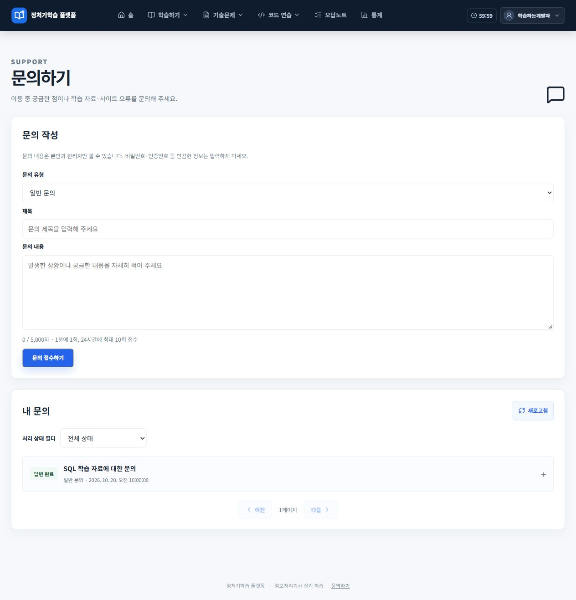

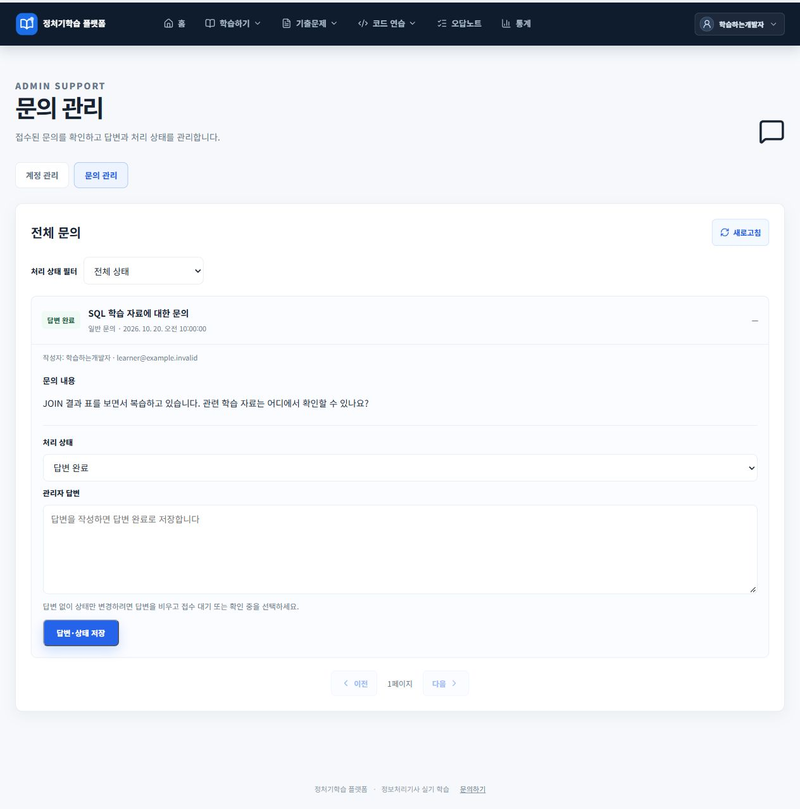

*문의 유형과 처리 상태를 구분하고, 관리자 답변은 사이트 안에서 확인하도록 구성했습니다. 화면의 문의와 계정 정보는 촬영용 예시입니다.*

관리자 계정 관리에서는 권한별 인원, 계정 검색, 한 페이지당 10명씩 표시하는 목록을 제공합니다. 사용자별 User·Pro 권한 변경과 풀이 상태 초기화 등의 운영 기능을 연결했습니다.

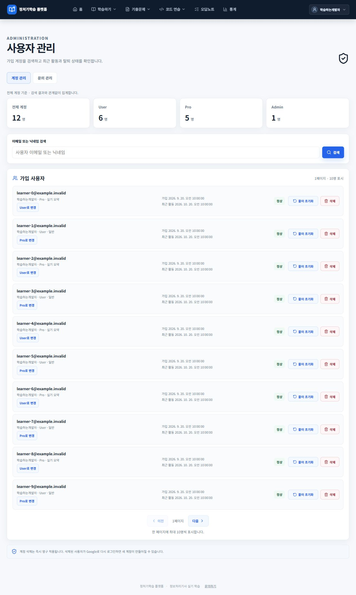

*전체 12명 등의 수치는 데모 데이터입니다. 실제 사용자의 이메일이나 계정 목록을 공개한 화면이 아닙니다.*

**운영을 고려한 선택:** 문의는 서버에서 입력을 검증하고 등록 빈도를 제한합니다. 관리자 답변 저장에서는 다른 탭의 수정을 덮어쓰지 않도록 갱신 시점을 확인하며, 계정 목록은 커서 기반 페이지 이동을 사용합니다.

### 3-9. 배포와 기능별 검증을 반복할 수 있게 구성하기

```text
GitHub 변경 이력 ── 연동 배포 ──> Vercel
                                  │
                             React 웹 앱 제공
                                  │
                       사용자의 브라우저에서 학습
                         ├─ 정적 학습·문제 데이터
                         ├─ 개인 PDF 구성
                         └─ Supabase
                              ├─ Google 로그인 연동
                              ├─ PostgreSQL 개인 기록·설정
                              ├─ RLS·RPC 권한 검사
                              └─ 계정 관리용 Edge Functions
```

| 기술 | 프로젝트에서 맡은 역할과 선택 이유 |
| --- | --- |
| React·JavaScript | 학습 카드, 문제 패널, 모달과 목록을 컴포넌트로 구성하고 여러 페이지에서 재사용 |
| React Router | 로그인 이후 이동, 보호 페이지, 학습 모달의 뒤로가기와 페이지 이동 상태 관리 |
| Vite | 로컬 개발 서버와 운영용 정적 번들 생성 |
| Supabase·PostgreSQL | 인증과 개인 기록 저장을 연결하고 RLS·RPC로 데이터 접근을 제어 |
| pdf-lib | 사용자별 카드 선택 결과를 브라우저에서 PDF로 구성 |
| Python 기반 PDF 도구 | 배포 전에 한글 카드 자료와 계산 예제를 조판하는 생성 작업 |
| GitHub·Vercel | 작업별 커밋과 푸시, 연동된 사이트 배포 |
| 기능별 검증 스크립트 | 코드 출력, SQL 결과 표, 답안·지문 구조, 권한, PDF와 화면 동작을 범위별로 확인 |

모바일에서는 모달을 열고 뒤로가기를 눌렀을 때 목록까지 이탈하는 문제가 있었습니다. 모달 선택 상태를 이동 기록과 연결해 뒤로가기가 모달부터 닫도록 개선했습니다. 다른 페이지로 이동하면 최상단에서 시작하고, 모달을 여닫을 때는 학습 카드의 기존 위치를 유지하도록 두 동작을 구분했습니다.

## 4. 결과 — 확인 가능한 수치와 변화

### 구현 규모

아래 수치는 **2026.10.31 소스 데이터 집계**입니다. 등록 회원 수, 합격률, 서비스 이용량이나 성능 개선율을 뜻하지 않습니다.

| 항목 | 수치 | 집계 기준 |
| --- | ---: | --- |
| 학습 과목 | 5개 | 학습 페이지의 과목 분류 |
| 전체 학습 카드 | 377개 | 전체 개요 107개 + 세부 학습 270개 |
| 일반 필답형 연습 | 601문제 | 현재 출제용 문제 데이터 |
| 코드·SQL 연습 | 840문제 | C·Java·Python·SQL 각 210문제 |
| 실기 복원 | 220문제 | 2023년 1회~2026년 2회 복원 데이터 |
| 실기 유사 | 200문제 | 복원 유형을 참고한 별도 변형 데이터 |
| 현재 출제용 문제 합계 | 1,861문제 | 601 + 840 + 220 + 200, 보관 문제 제외 |
| 기본 실기 요약 | 116개 카드 | 공통 초기 목록 |
| 개인 요약 추가 대상 | 270개 카드 | 세부 학습 카드 전체 |
| 계정 권한 | 3단계 | User·Pro·Admin |

문제 수는 등록 문항 수이며 서로 다른 개념·알고리즘이 각각 그만큼 있다는 의미는 아닙니다. 같은 유형의 변형 문제가 포함됩니다.

### 사용 흐름의 변화

| 개선 전의 불편 | 반영한 결과 |
| --- | --- |
| 학습 자료가 길어 빠른 복습과 깊이 있는 학습을 구분하기 어려움 | 같은 주제를 빠른 요약·상세 정리로 선택 |
| 코드 정답만 보고 실행 과정을 이해하기 어려움 | 주석 코드·단계별 풀이·SQL 결과 표를 함께 제공 |
| 새 문제와 이미 푼 문제가 섞임 | 새 출제·오답 재풀이·풀이 기록의 경로 분리 |
| 시험 전 개인 요약을 다시 편집해야 함 | 개인 카드 목록을 그대로 PDF 내보내기에 연결 |
| 모달 뒤로가기 시 학습 목록까지 벗어남 | 이동 기록과 모달 상태를 연결해 모달부터 닫기 |
| 문제 제목에서 답의 방향을 추측할 수 있음 | 풀이·복습 화면의 코드 제목을 언어 중심으로 통일 |

### 품질 확인 기록

기존 검수 문서에는 현재·보관 문제 **2,341문항**, 문제·정답·중간 계산·SQL 풀이 표 **2,420개**에 대한 회귀 검사 범위가 기록되어 있습니다. 별도로 주소·마스크 12문항, CPU 대기시간 13문항, 페이지 교체 10문항 등 **35문항을 독립 계산으로 검산**한 기록이 있습니다.

이는 기존 검수 작업의 범위이며, 이번 소개 문서 작성 중 전체 검사를 다시 수행했다는 뜻은 아닙니다. 구조 검증·실행 검증·자연어 검토는 서로 확인할 수 있는 범위가 다르므로, 검사 통과를 모든 설명의 무오류 보장으로 표현하지 않습니다.

자료 근거: [남은 문제 5차 검수](docs/REMAINING_QUESTION_AUDIT.md), [표·해설 검수](docs/PROBLEM_TABLE_SOLUTION_AUDIT.md).

## 5. 회고 및 배운 점 — 다시 한다면 무엇을 바꿀 것인가?

### 기능의 개수보다 학습 흐름을 먼저 설계하기

요약, 문제, 오답노트, 통계를 각각 만드는 것보다 서로 자연스럽게 이어지게 하는 것이 중요했습니다. 특히 이미 푼 문제의 재출제를 막으면서도 해설은 다시 볼 수 있어야 했기 때문에, ‘새 문제를 푸는 화면’과 ‘기록을 복습하는 화면’의 책임을 분리할 필요가 있었습니다.

다시 시작한다면 문제 상태와 화면 이동 규칙을 먼저 정의하고, 처음부터 학습 → 풀이 → 복습의 작은 흐름 하나를 완성한 뒤 콘텐츠를 확대하겠습니다.

### 데이터 양보다 답안·해설의 일관성을 먼저 확보하기

문제를 많이 추가해도 표의 값이나 주석의 중간 계산이 어긋나면 학습 신뢰도가 떨어집니다. 실제 실행 결과, 중간 표, 자연어 설명을 함께 검토해야 한다는 점을 배웠습니다.

앞으로는 문제마다 출제 의도, 정답 근거, 실행 검증 방식, 검수 상태를 더 일관된 구조로 관리하고, 새 문항을 추가할 때 해당 유형의 검증을 함께 붙이는 방식으로 개선하겠습니다.

### 작은 화면 동작이 학습의 연속성에 영향을 준다

모바일에서 모달 뒤로가기가 목록을 벗어나게 하거나, 같은 언어 메뉴를 눌러도 난이도 선택으로 돌아가지 않으면 학습자가 흐름을 잃습니다. 기능 자체가 존재하는 것과 실제로 편하게 사용할 수 있는 것은 다르다는 점을 확인했습니다.

다음 단계에서는 뒤로가기·새로고침·동일 메뉴 재선택·계정 전환 같은 상태 전환을 주요 사용자 시나리오로 정리하고, 자동화된 브라우저 회귀 검증을 더 체계적으로 구성하겠습니다.

### 권한과 개인화는 화면 밖에서도 확인해야 한다

메뉴를 감추는 것만으로는 다른 사용자의 데이터 접근을 막을 수 없습니다. 개인 설정과 풀이 기록의 소유권, 관리자 작업의 서버 권한, 세션 유효성을 나누어 확인하는 구조가 필요했습니다.

향후 콘텐츠 자체를 비공개로 제공해야 한다면 정적 자산 배포와 페이지 접근 제어의 차이를 고려해 서버 제공 방식부터 다시 설계하겠습니다.

### 실제 사용 지표로 다음 개선의 우선순위 정하기

현재는 구현한 콘텐츠와 검증 범위를 수치로 제시할 수 있지만, 실제 학습 시간 단축이나 합격률 개선을 주장할 측정 데이터는 없습니다. 다음 단계에서는 개인정보 수집을 최소화하면서 학습 진입, 문제 제출, 오답 재풀이 같은 주요 흐름의 이용 상태와 오류를 관찰하고, 그 결과를 바탕으로 개선 우선순위를 정하겠습니다.

---

### 구현 근거와 문서 활용

| 내용 | 관련 파일·문서 |
| --- | --- |
| 페이지·보호 경로 | [App.jsx](src/App.jsx) |
| 학습·문제 수 집계 | [studyData.js](src/data/studyData.js) |
| 개인 요약 카드 목록 | [examSummaryCatalog.js](src/data/examSummaryCatalog.js) |
| 계정 권한 | [권한 설계 문서](docs/app-roles.md) |
| 개인 PDF | [PDF 생성 문서](docs/exam-summary-pdf.md) |
| 단일 세션 | [세션 정책과 검증 범위](docs/single-session.md) |
| 문의 기능 | [문의 처리 문서](docs/support-inquiries.md) |

이 README는 GitHub 저장소 첫 화면에 표시됩니다. 기능별 캡처는 `docs/portfolio/screenshots/`에 보관하며, 이미지와 구현 근거 링크는 저장소 루트를 기준으로 연결합니다.
